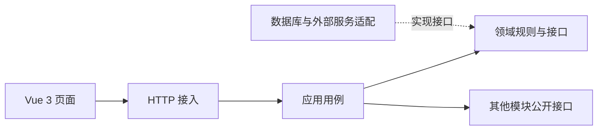

# 01 需求与系统设计

[返回首页](../README.md)

## 强制规则

| 编号 | 适用 | 执行要求 | 检查与证据 | 责任 |
| --- | --- | --- | --- | --- |
| ARC-001 | 新功能、需求变更 | 描述目标用户、范围、业务规则、异常场景、验收条件；影响现有行为时说明兼容性 | 需求评审、验收场景 | 业务负责人 |
| ARC-002 | 新项目、重大变更 | 绘制系统上下文、模块关系、部署和关键交互图；标注信任边界、外部依赖和数据归属 | 设计文档、评审结论 | 技术负责人 |
| ARC-003 | 模块化单体 | 按业务能力划分模块，暴露明确接口；禁止循环依赖、跨模块访问内部实现或直接写其他模块的数据 | 依赖分析、代码评审 | 技术负责人 |
| ARC-004 | 后端业务实现 | 分清接入、应用编排、领域规则、基础设施职责；外部接口模型与持久化实体隔离；接口层不承载核心业务规则 | 结构与关键流程评审 | 后端负责人 |
| ARC-005 | 上线前、容量变化 | 明确峰值负载、数据量、时延、可用性、RPO、RTO及测量口径；用测试或演练证明 | 技术基线、性能与恢复报告 | 技术负责人 |
| ARC-006 | 外部依赖、后台任务 | 定义超时、限流、失败处理、重试条件、重复执行语义、补偿与告警；禁止无限重试 | 故障场景测试、设计 | 后端负责人 |
| ARC-007 | 关键技术选择 | 记录备选方案、决策、成本、约束和重新评估条件；拆微服务须有可量化收益及数据边界方案 | 架构决策记录 | 技术负责人 |
| ARC-008 | 多租户或数据隔离 | 从可信身份上下文获取租户和数据范围，覆盖查询、更新、缓存、导出、任务及审计 | 隔离设计、越权用例 | 技术负责人 |

## 默认模块和依赖方向

按业务模块组织，而不是把所有业务放进统一的 controller／service／mapper 目录。每个模块可以使用下列职责划分；简单 CRUD 可减少层数，但不得混淆业务和技术职责。

```text
order/
  api/             对其他模块公开的接口与数据契约
  interfaces/      HTTP 等输入适配、参数转换、身份上下文
  application/     用例编排、事务与权限协调
  domain/          业务模型、规则、基础设施接口
  infrastructure/  存储、消息、外部服务适配
```



共享模块只容纳稳定、无业务归属的能力。跨模块查询优先调用公开查询接口，复杂报表可建立独立只读模型，必须登记同步延迟和所有权。业务事件标注提交时点；重要异步事件需可靠持久化、重放和去重设计。

## 非功能目标填写方法

目标须同时给出环境、负载、数据量、测量区间和判据，例如：“预生产，10 万订单，50 个并发用户，预热 5 分钟后持续 30 分钟，订单列表 P95 ≤ 500ms、服务端错误率 < 0.1%”。这只是示例，项目以评审后的实际目标为准。

RPO 表示可接受的数据丢失时间窗口，RTO 表示从业务中断到恢复业务服务的时间。可用性目标需说明服务时段、成功判据、观测位置及计划维护是否计入。不能只写“高性能”“高可用”。

## 演进与失败设计

推荐在以下证据出现时评估微服务：模块需独立扩缩容或发布、团队职责和数据边界稳定、故障隔离收益超过分布式成本。评估时必须处理调用超时、认证传播、契约版本、分布式一致性、追踪、发布和运维投入。

关键失败路径至少包含数据库不可用、外部调用超时、消息重复、并发修改、客户端重试和实例退出。为每个路径说明用户看到什么、是否产生副作用、如何恢复和告警；涉及支付等不可逆副作用时增加对账与人工处置方案。

配套：[需求](../templates/02-requirements.md)、[设计](../templates/03-system-design.md)、[ADR](../templates/04-adr.md)、[设计清单](../checklists/01-design.md)。
