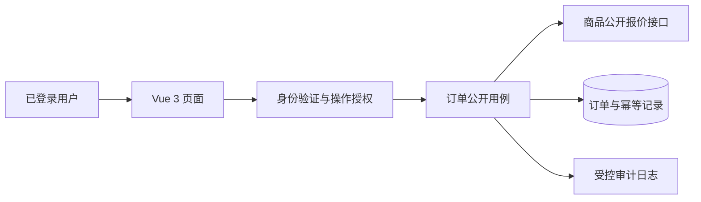
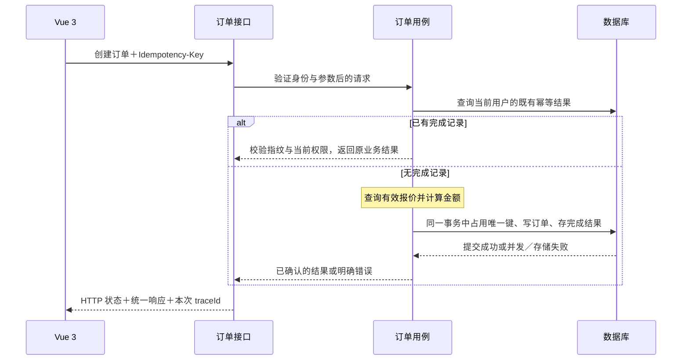

# 订单贯穿示例

[返回首页](../../README.md)

本例用于说明规范如何联动，不是可运行的业务工程，也不声称已完成业务测试。字段、场景和流程可直接作为新项目评审样例。

## 示例基线与需求

示例服务为已登录用户提供订单创建、本人订单列表和详情。使用 Java＋Vue 3 的模块化单体；数据库由实施项目选定。认证采用经验证的 Bearer 凭证，浏览器凭证存储与续期方案须另行安全评审；本例不指定 JWT。

本例不包含付款、库存预占、取消、退款和多租户；实际加入时必须增加状态机、补偿、授权和相关测试。列表查询始终按可信用户身份过滤，不接受 body 或 query 中的 ownerId 覆盖身份。

| 项目 | 示例约定 |
| --- | --- |
| 商品 | `productId: "9007199254740995"`，服务端有效报价 `12.50 CNY` |
| 创建参数 | productId、quantity；数量 1～100，不接收客户端价格 |
| 成功结果 | 订单 ID `"9007199254740993"`，数量 2，总额 `"25.00"`，状态 `CREATED` |
| 幂等 | 范围为用户＋创建操作＋键；24 小时；不同业务载荷返回 409 |
| 时间 | UTC 时间点，如 `2026-11-21T02:00:00Z` |
| 分页 | page=1、pageSize=20，最大 100；排序为 createdAt DESC、id DESC，不暴露自定义排序参数 |
| 深分页 | 本例 page 上限 1000，超出返回 400；更大数据检索另行设计 |
| 资源不可见 | 不属于当前用户的订单与不存在订单均返回 404 |

示例运行目标仅用于说明填写口径：预生产 10 万订单、50 个并发用户，预热 5 分钟后测量 30 分钟，列表 P95 ≤ 500ms、服务端错误率 < 0.1%；业务时段 09:00～18:00（Asia/Shanghai）按月计算成功请求占比 ≥ 99.5%，维护窗口计入；RPO ≤ 24 小时、RTO ≤ 4 小时。正式项目须用实测确认能力并重新评审目标，示例没有性能或恢复达标结论。

| 需求／验收 | 行为 | 关联用例 |
| --- | --- | --- |
| REQ-ORDER-001／AC-001 | 有权限用户按服务端报价创建一笔订单 | TC-ORDER-001、TC-ORDER-005 |
| REQ-ORDER-001／AC-002 | 超时重试或并发不会重复创建 | TC-ORDER-003、TC-ORDER-004、TC-ORDER-006、TC-ORDER-007 |
| REQ-ORDER-002／AC-003 | 只能查询自己订单，分页结果正确 | TC-ORDER-002、TC-ORDER-008 |
| REQ-ORDER-003／AC-004 | 前端清晰展示加载、错误和数据，金额和 ID 无精度损失 | TC-ORDER-009、TC-ORDER-010 |

## 系统与关键流程

事务使用唯一约束 `(owner_id, operation, idempotency_key)`。业务写入和完成记录在同一事务内提交，失败同时回滚。并发插入失败后必须退出失败事务，再读取已提交结果；不能在已失效事务中继续操作。锁等待超时可返回 `COMMON.REQUEST_IN_PROGRESS`，等待与重试必须有界。结果未知先查询确认，不自动重复副作用；具体数据库机制需在真实数据库验证。

幂等指纹只包含规范化的 `productId、quantity`；相同请求的重放使用原价格快照。重放不重新询价，也不能绕过当前授权。新业务意图才产生新键。24 小时以完成提交时间计算；清理只删除已过期完成记录，保留期后不承诺该键去重，本例前端须告知用户核对订单后再重建意图。

## 逻辑数据模型

| 实体 | 字段与约束 | 说明 |
| --- | --- | --- |
| orders | id 主键；owner_id；product_id；quantity；unit_price；total_amount；currency；status；created_at | 数量 1～100；CNY 金额十进制两位；状态 CREATED；ID 外传字符串 |
| order_idempotency | owner_id；operation；idempotency_key；request_fingerprint；order_id；response_snapshot；completed_at；expires_at | 唯一键含用户、操作、键；与订单同事务；快照不持久化本次 traceId |

列表索引候选为 `(owner_id, created_at, id)`，按实际数据库查询计划验证方向、选择性和规模；幂等清理需要 expires_at 索引或等效机制。数据库产品确定后才填写实际 DDL、精度、ID 生成与锁策略，不提供伪装为通用 SQL 的脚本。

## 示例入口

- [OpenAPI 契约](openapi.yaml)：创建、列表、详情及公共错误模型。
- [Java 示例](java-example.md)：金额规则与事务边界说明。
- [Vue 3 示例](vue-example.md)：字符串字段与请求竞态处理。
- [测试与发布样例](verification-and-release.md)：上述验收条件的验证与恢复安排。

### 发布迁移示例

首次增加订单与幂等表是扩展变更；旧应用不使用新表，可以在核对兼容性后回滚应用并保留数据，不删除已创建订单。后续删除或改变列类型不能套用此结论。生产操作需要项目专用[数据变更](../../templates/06-data-change.md)和[发布方案](../../templates/11-release.md)。
